# Hi, I'm Pinto 👋

📍 **Jakarta, Indonesia** | 💻 **Full-stack & platform engineer** | 🗓️ **10+ years**

I'm a software engineer on an OTT platform, working on everything from the web app people watch on to the services and Kubernetes platform behind it, and more recently the AI tools built on top of both. I like building things that scale, stay fast and are easy to maintain. Lately, I also play vibe-code janitor 🧹, giving vibe-coded prototypes a proper scrub so they survive prime-time traffic.

Along the way I've mentored engineers and worked as an engineering manager, and I enjoy helping a team grow as much as shipping the code.

## My year, woven

<picture>
  <source media="(prefers-color-scheme: dark)" srcset="assets/woven-dark.svg">
  
</picture>

Each diamond is a day of work across GitHub and GitLab, woven like songket thread. Gold marks the busiest days.

<!-- selvedge: guestbook strip goes here after launch -->
<!-- You read the source. The top border isn't only decoration: ▲ is 1, ▼ is 0. -->

## Side quests 🗺️

### Tools & libraries

- 🔌 **[socketto](https://github.com/karsanda/socketto)** - A WebSocket wrapper for the browser in under 1 kB
- 🇮🇩 **[postcss-indonesian-stylesheets](https://github.com/karsanda/postcss-indonesian-stylesheets)** - A PostCSS plugin for writing CSS in Bahasa Indonesia: `warna: merah paksakan!` compiles to `color: red !important`
- 👁️ **[barong](https://github.com/karsanda/barong)** - A visual regression testing tool I contribute to: Playwright screenshots, compared pixel by pixel, to catch the UI changes our mortal eyes would miss

### Apps

- 💸 **[moneyflow](https://github.com/karsanda/moneyflow)** - Follow the money: drop in a bank statement PDF, get your income and spending parsed, summarised and exportable
- 🧭 **[blueprint](https://github.com/karsanda/blueprint)** - A desktop app that puts Claude Code, terminals and a review of what Claude changed in one window, with a drafting-table look

### Experiments

- 📰 **[Hacker News, five ways](https://github.com/karsanda/monorepo)** - The same Hacker News reader built in Next.js, Nuxt, SvelteKit, SolidStart and Qwik City, to compare them honestly

### Setup

- ⚙️ **[dotfiles](https://github.com/karsanda/dotfiles)** - My terminal setup for Linux and macOS
- 🧰 **[vim-config](https://github.com/karsanda/vim-config)** - A shared Vim configuration with support for Hack, Ruby, JavaScript and a few templating languages

## Connect

## Off the keyboard

When I'm not coding, you'll find me travelling ✈️, jogging 🏃, hunting down good food 🍜, brewing my own coffee ☕, hunting monsters in Monster Hunter 🎮, or (ironically, for this section) tinkering with mechanical keyboards ⌨️.

**Terima kasih sudah mampir!** 👋 (Thanks for stopping by!)
